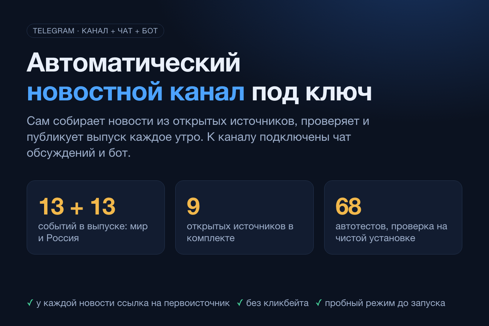

# Politpersona — автоматический новостной канал, чат и бот

**Работающий проект:** канал [@politpersona](https://t.me/politpersona) · бот [@ru_politics_news_bot](https://t.me/ru_politics_news_bot)

Система сама ведёт новостной Telegram-канал: каждое утро собирает события мира и России из открытых источников, проверяет их по редакционным правилам и публикует выпуск «13 + 13». К каналу подключены чат обсуждений и бот.

> Исходный код закрытый. Здесь описание проекта.

## Как работает

- **Сбор:** 9 открытых RSS-источников; сбой одного не останавливает выпуск, дубли отбрасываются, сообщения об одном событии объединяются в сюжет.
- **Проверка:** окно свежести 36 часов, ссылка на первоисточник, атрибуция заявлений («заявил», «по данным»), фильтр кликбейта.
- **Публикация:** утренний выпуск 13 + 13, вечерний «главное с утра», срочные посты по порогу подтверждений с лимитом и тихими часами.
- **Бот:** ответ на слово или тему двумя блоками «Мир» и «Россия», `/fresh` за 3 часа, поиск по базе событий.
- **Защита:** пустые и без источника выпуски в канал не уходят, секреты маскируются в журналах, есть пробный режим без публикации.

## Стек

Запуск как служба systemd от отдельного пользователя, 60+ автотестов.

## Автор

Олег · [gonka.blog](https://gonka.blog) · textsmen@gmail.com
